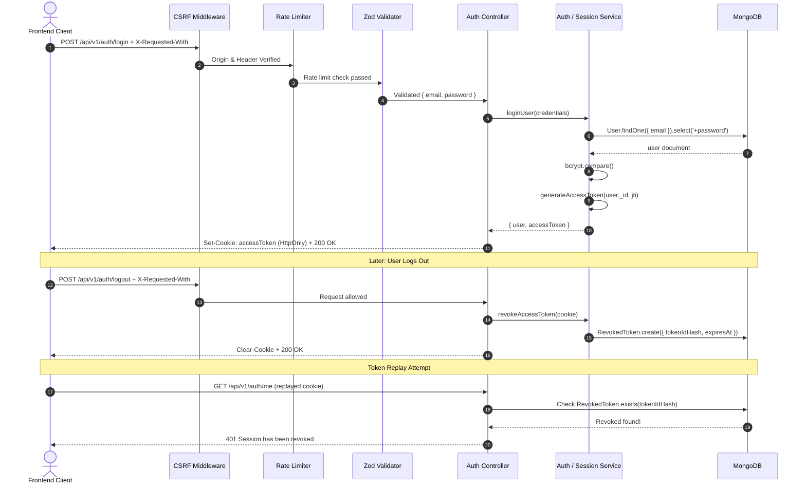

# Smart Hostel Management System

A modern, scalable Hostel Management System backend built with **Node.js**, **Express**, and **MongoDB (Mongoose)** featuring robust authentication, role-based access control (RBAC), token revocation & session management, CSRF protection, Zod request schema validation, dedicated brute-force rate limiters, admin bootstrap tooling, and an automated integration test suite.

---

## Table of Contents

- [Overview](#overview)
- [Tech Stack](#tech-stack)
- [Project Architecture](#project-architecture)
- [Environment Variables](#environment-variables)
- [Getting Started](#getting-started)
  - [Prerequisites](#prerequisites)
  - [Installation](#installation)
  - [Running the Server](#running-the-server)
  - [Running Automated Tests](#running-automated-tests)
  - [Bootstrapping an Admin Account](#bootstrapping-an-admin-account)
- [API Documentation](#api-documentation)
  - [Authentication Endpoints](#authentication-endpoints)
    - [1. Health Check](#1-health-check)
    - [2. User Registration](#2-user-registration)
    - [3. User Login](#3-user-login)
    - [4. User Logout (Session Revocation)](#4-user-logout-session-revocation)
    - [5. Current User Profile (`/me`)](#5-current-user-profile-me)
    - [6. Development Verification Routes](#6-development-verification-routes)
  - [Admin User Management Endpoints](#admin-user-management-endpoints)
    - [7. List All Users (Paginated & Filterable)](#7-list-all-users-paginated--filterable)
    - [8. Get User by ID](#8-get-user-by-id)
    - [9. Update Basic User Details](#9-update-basic-user-details)
    - [10. Activate / Deactivate User Status](#10-activate--deactivate-user-status)
    - [11. Update User Role](#11-update-user-role)
- [Security & Validation Architecture](#security--validation-architecture)
  - [CSRF Protection & Custom Header Requirement](#csrf-protection--custom-header-requirement)
  - [Token Revocation & Session Management](#token-revocation--session-management)
  - [Request Validation with Zod](#request-validation-with-zod)
  - [Dedicated Authentication Rate Limiters](#dedicated-authentication-rate-limiters)
  - [Centralized Error Handling](#centralized-error-handling)
- [Authentication & Security Flow](#authentication--security-flow)
- [Git Branching Strategy](#git-branching-strategy)

---

## Overview

The Smart Hostel system automates and streamlines hostel administration tasks including:
- **Secure Authentication & Session Lifecycle**: Student registration, password hashing with bcrypt, JWT issued with unique `jti`, HTTP-only cookies, token blacklisting/revocation upon logout, and CSRF protection.
- **Role-Based Access Control (RBAC)**: Strict permission tiers for `student`, `warden`, `staff`, and `admin`.
- **User Management**: Administrative APIs to list, filter, search, inspect, update, activate/deactivate, and reassign roles to users with built-in guardrails against self-demotion or self-lockout.
- **Hostel Domain Schemas**: Modular Mongoose schemas for hostels, rooms, beds, allocations, complaints, fee structures, payment records, notices, and visitor logs.
- **Enterprise Security**: Strict input validation with Zod, rate limiting, security HTTP headers with Helmet, and CORS origin whitelisting.

---

## Tech Stack

- **Runtime**: Node.js (v18+, ES Modules)
- **Framework**: Express.js
- **Database**: MongoDB with Mongoose ODM
- **Schema Validation**: Zod (`zod`)
- **Authentication & Security**:
  - `jsonwebtoken`: Access tokens with unique identifier (`jti`), issuer, and audience claims
  - `bcryptjs`: Password hashing with 12 salt rounds
  - `helmet`: Security HTTP response headers
  - `cors`: Whitelisted cross-origin resource sharing
  - `express-rate-limit`: Brute-force protection & API request throttling
  - `cookie-parser`: Secure HTTP-only cookie management
- **Logging**: Morgan HTTP logger (development mode)
- **Testing & Quality Assurance**:
  - Node.js native test runner (`node --test`)
  - `supertest`: HTTP endpoint integration testing
  - `mongodb-memory-server`: Isolated in-memory MongoDB test database

---

## Project Architecture

```text
smart-hostel/
├── client/                               # Frontend application (React / Vite)
│   ├── src/
│   │   ├── components/
│   │   ├── hooks/
│   │   ├── layouts/
│   │   ├── pages/
│   │   └── services/
│   └── package.json
│
├── server/                               # Backend API service
│   ├── scripts/
│   │   └── bootstrap-admin.js            # Initial admin elevation tool
│   ├── src/
│   │   ├── config/
│   │   │   ├── db.js                     # MongoDB connection handler
│   │   │   └── env.js                    # Validated environment configurations
│   │   ├── controllers/
│   │   │   ├── auth.controller.js        # Register, login, logout, me handlers
│   │   │   └── user.controller.js        # Admin user management handlers
│   │   ├── middlewares/
│   │   │   ├── auth.middleware.js        # JWT verification, revocation check & req.user
│   │   │   ├── authRateLimit.middleware.js # Registration & login brute-force limiters
│   │   │   ├── csrf.middleware.js        # CSRF check (X-Requested-With & origin verification)
│   │   │   ├── error.middleware.js       # Centralized error handler
│   │   │   ├── notFound.middleware.js    # 404 route handler
│   │   │   ├── role.middleware.js        # Role-based authorization guard (RBAC)
│   │   │   └── validate.middleware.js    # Zod schema validation middleware
│   │   ├── models/
│   │   │   ├── allocation.model.js       # Room/bed student allocations
│   │   │   ├── bed.model.js              # Bed slots within rooms
│   │   │   ├── complaint.model.js        # Maintenance & grievance tickets
│   │   │   ├── fee.model.js              # Fee structures & dues
│   │   │   ├── hostel.model.js           # Hostel blocks & properties
│   │   │   ├── notice.model.js           # Announcements & official notices
│   │   │   ├── payment.model.js          # Payment transaction records
│   │   │   ├── revokedToken.model.js     # Token revocation blacklist with TTL expiry
│   │   │   ├── room.model.js             # Room configurations & capacities
│   │   │   ├── user.model.js             # User accounts & role definitions
│   │   │   └── visitor.model.js          # Visitor log entries
│   │   ├── routes/
│   │   │   ├── auth.routes.js            # /api/v1/auth routing
│   │   │   └── user.routes.js            # /api/v1/users admin routing
│   │   ├── services/
│   │   │   ├── auth.service.js           # Registration & authentication business logic
│   │   │   ├── session.service.js        # Token blacklisting & session revocation logic
│   │   │   └── user.service.js           # User querying, filtering & updating logic
│   │   ├── utils/
│   │   │   ├── ApiError.js               # Standardized application error class
│   │   │   ├── asyncHandler.js           # Async route wrapper for exception handling
│   │   │   ├── response.js               # Standardized JSON response envelope
│   │   │   └── token.js                  # JWT issuance, verification & SHA-256 hashing
│   │   ├── validators/
│   │   │   ├── auth.validator.js         # Register & login Zod schemas
│   │   │   └── user.validator.js         # User list queries & update schemas
│   │   ├── app.js                       # Express app setup & middleware pipeline
│   │   └── server.js                    # HTTP listener bootstrap
│   ├── tests/
│   │   └── auth.integration.test.js     # End-to-end integration tests
│   ├── .env.example
│   └── package.json
└── README.md
```

---

## Environment Variables

Create and configure a `.env` file in the `server/` directory:

```env
PORT=5001
MONGODB_URI=mongodb://127.0.0.1:27017/hostel_management
JWT_SECRET=your_super_secret_jwt_key_here
JWT_EXPIRES_IN=7d
CLIENT_URL=http://localhost:5173
NODE_ENV=development
```

> **macOS Note**: Port `5001` is used by default because port `5000` is reserved by the macOS AirPlay Receiver (`AirTunes`).

---

## Getting Started

### Prerequisites
- **Node.js**: v18.0.0 or higher
- **MongoDB**: Local MongoDB daemon or MongoDB Atlas URI

### Installation

1. Clone the repository:
   ```bash
   git clone https://github.com/shiv-pencia/SmartHostel-.git
   cd SmartHostel-
   ```

2. Install backend dependencies:
   ```bash
   cd server
   npm install
   ```

3. Ensure `.env` is populated with valid values in `server/.env`.

### Running the Server

- **Development Mode** (with automatic restart via nodemon):
  ```bash
  npm run dev
  ```
- **Production Mode**:
  ```bash
  npm start
  ```

### Running Automated Tests

The backend includes a comprehensive integration test suite running on Node's native test runner with `supertest` and `mongodb-memory-server` (no external MongoDB instance required):

```bash
cd server
npm test
```

### Bootstrapping an Admin Account

To promote the first registered user to administrator in a development environment:

1. Register an initial user (e.g. `admin@hostel.edu`) via the `/api/v1/auth/register` API.
2. Run the bootstrap script:
   ```bash
   cd server
   BOOTSTRAP_ADMIN_EMAIL="admin@hostel.edu" node scripts/bootstrap-admin.js
   ```

---

## API Documentation

Base URL: `http://localhost:5001`

> [!IMPORTANT]
> **CSRF Protection Header**: All state-mutating requests (`POST`, `PATCH`, `PUT`, `DELETE`) require the `X-Requested-With: XMLHttpRequest` header. Requests without this header or from untrusted origins are rejected with `403 Forbidden`.

---

### Authentication Endpoints

#### 1. Health Check

Checks if the server is alive and operational.

- **Method**: `GET`
- **Route**: `/api/v1/health`
- **Authentication**: None

```bash
curl -X GET http://localhost:5001/api/v1/health
```

**Response (`200 OK`)**:
```json
{
  "success": true,
  "message": "Smart Hostel API is running"
}
```

---

#### 2. User Registration

Registers a new student account with strict Zod validation and rate limiting.

- **Method**: `POST`
- **Route**: `/api/v1/auth/register`
- **Rate Limit**: 5 attempts per IP per hour
- **Required Headers**: `Content-Type: application/json`, `X-Requested-With: XMLHttpRequest`

**Request Body Schema**:
| Field | Type | Required | Constraints |
| :--- | :--- | :--- | :--- |
| `name` | String | Yes | 2 to 100 characters, trimmed |
| `email` | String | Yes | Valid email format, lowercase |
| `password` | String | Yes | 8 to 128 characters, max 72 bytes |
| `phone` | String | No | 10 to 15 digits, optional `+` prefix |

**Sample Request**:
```bash
curl -X POST http://localhost:5001/api/v1/auth/register \
  -H "Content-Type: application/json" \
  -H "X-Requested-With: XMLHttpRequest" \
  -d '{
    "name": "Shiv Prakash",
    "email": "shiv@example.com",
    "password": "StudentPass@123",
    "phone": "+919876543210"
  }'
```

**Response (`201 Created`)**:
```json
{
  "success": true,
  "message": "Student registered successfully",
  "data": {
    "user": {
      "id": "6acb89cdcca5f3892ad245b6",
      "name": "Shiv Prakash",
      "email": "shiv@example.com",
      "phone": "+919876543210",
      "role": "student",
      "isActive": true,
      "lastLoginAt": null,
      "createdAt": "2026-10-12T10:00:00.000Z",
      "updatedAt": "2026-10-12T10:00:00.000Z"
    }
  }
}
```

---

#### 3. User Login

Authenticates user credentials, sets an `accessToken` HTTP-only cookie, and logs the login timestamp.

- **Method**: `POST`
- **Route**: `/api/v1/auth/login`
- **Rate Limit**: 10 failed attempts per IP per 15 minutes
- **Required Headers**: `Content-Type: application/json`, `X-Requested-With: XMLHttpRequest`

**Sample Request**:
```bash
curl -i -X POST http://localhost:5001/api/v1/auth/login \
  -H "Content-Type: application/json" \
  -H "X-Requested-With: XMLHttpRequest" \
  -d '{
    "email": "shiv@example.com",
    "password": "StudentPass@123"
  }'
```

**Response (`200 OK`)**:
```http
HTTP/1.1 200 OK
Set-Cookie: accessToken=eyJhbGciOiJIUzI1NiIsInR5cCI6IkpXVCJ9...; Max-Age=900; Path=/; HttpOnly; SameSite=Lax
Cache-Control: no-store

{
  "success": true,
  "message": "Login successful",
  "data": {
    "user": {
      "id": "6acb89cdcca5f3892ad245b6",
      "name": "Shiv Prakash",
      "email": "shiv@example.com",
      "role": "student",
      "isActive": true,
      "lastLoginAt": "2026-10-12T10:05:00.000Z"
    }
  }
}
```

---

#### 4. User Logout (Session Revocation)

Revokes the active JWT access token in MongoDB using its cryptographic identifier (`jti`) and clears the HTTP-only cookie.

- **Method**: `POST`
- **Route**: `/api/v1/auth/logout`
- **Authentication**: Optional (clears cookies regardless, revokes token if valid)
- **Required Headers**: `X-Requested-With: XMLHttpRequest`

**Sample Request**:
```bash
curl -i -X POST http://localhost:5001/api/v1/auth/logout \
  -H "X-Requested-With: XMLHttpRequest" \
  --cookie "accessToken=eyJhbGciOiJIUzI1NiIsInR5cCI6IkpXVCJ9..."
```

**Response (`200 OK`)**:
```json
{
  "success": true,
  "message": "Logout successful"
}
```

---

#### 5. Current User Profile (`/me`)

Retrieves the currently authenticated user's profile.

- **Method**: `GET`
- **Route**: `/api/v1/auth/me`
- **Authentication**: Required (`accessToken` Cookie)

**Sample Request**:
```bash
curl -X GET http://localhost:5001/api/v1/auth/me \
  --cookie "accessToken=eyJhbGciOiJIUzI1NiIsInR5cCI6IkpXVCJ9..."
```

**Response (`200 OK`)**:
```json
{
  "success": true,
  "message": "Current user retrieved successfully",
  "data": {
    "user": {
      "id": "6acb89cdcca5f3892ad245b6",
      "name": "Shiv Prakash",
      "email": "shiv@example.com",
      "role": "student",
      "isActive": true
    }
  }
}
```

---

#### 6. Development Verification Routes

Available when `NODE_ENV=development`:
- `GET /api/v1/auth/profile-check`: Any valid authenticated user
- `GET /api/v1/auth/warden-check`: Only users with `warden` or `admin` role

---

### Admin User Management Endpoints

All routes under `/api/v1/users` require an authenticated user with `role: "admin"`.

#### 7. List All Users (Paginated & Filterable)

Lists user accounts with query-based filtering and pagination.

- **Method**: `GET`
- **Route**: `/api/v1/users`
- **Authentication**: Required (`admin`)
- **Query Parameters**:
  - `page`: Page number (integer, min: 1, default: `1`)
  - `limit`: Items per page (integer, min: 1, max: 100, default: `10`)
  - `search`: Case-insensitive text search matching `name` or `email`
  - `role`: Filter by role (`student`, `warden`, `staff`, `admin`)
  - `status`: Filter by account status (`active`, `inactive`)

**Sample Request**:
```bash
curl -X GET "http://localhost:5001/api/v1/users?role=student&status=active&page=1&limit=10" \
  --cookie "accessToken=ADMIN_TOKEN..."
```

**Response (`200 OK`)**:
```json
{
  "success": true,
  "message": "Users retrieved successfully",
  "data": [
    {
      "id": "6acb89cdcca5f3892ad245b6",
      "name": "Shiv Prakash",
      "email": "shiv@example.com",
      "phone": "+919876543210",
      "role": "student",
      "isActive": true,
      "createdAt": "2026-10-12T10:00:00.000Z"
    }
  ],
  "meta": {
    "page": 1,
    "limit": 10,
    "total": 1,
    "totalPages": 1
  }
}
```

---

#### 8. Get User by ID

Fetches a single user record by their MongoDB ID.

- **Method**: `GET`
- **Route**: `/api/v1/users/:userId`
- **Authentication**: Required (`admin`)

**Sample Request**:
```bash
curl -X GET http://localhost:5001/api/v1/users/6acb89cdcca5f3892ad245b6 \
  --cookie "accessToken=ADMIN_TOKEN..."
```

---

#### 9. Update Basic User Details

Updates non-sensitive profile information (`name`, `phone`).

- **Method**: `PATCH`
- **Route**: `/api/v1/users/:userId`
- **Authentication**: Required (`admin`)
- **Required Headers**: `Content-Type: application/json`, `X-Requested-With: XMLHttpRequest`

**Sample Request**:
```bash
curl -X PATCH http://localhost:5001/api/v1/users/6acb89cdcca5f3892ad245b6 \
  -H "Content-Type: application/json" \
  -H "X-Requested-With: XMLHttpRequest" \
  --cookie "accessToken=ADMIN_TOKEN..." \
  -d '{
    "name": "Shiv Pencia",
    "phone": "+919876543299"
  }'
```

---

#### 10. Activate / Deactivate User Status

Enables or disables a user account. Deactivated users cannot log in or authenticate.

- **Method**: `PATCH`
- **Route**: `/api/v1/users/:userId/status`
- **Authentication**: Required (`admin`)
- **Required Headers**: `Content-Type: application/json`, `X-Requested-With: XMLHttpRequest`
- **Safety Guards**:
  - Administrators cannot deactivate their own account (`403 Forbidden`).
  - Administrator accounts cannot have their status altered through this endpoint (`403 Forbidden`).

**Sample Request**:
```bash
curl -X PATCH http://localhost:5001/api/v1/users/6acb89cdcca5f3892ad245b6/status \
  -H "Content-Type: application/json" \
  -H "X-Requested-With: XMLHttpRequest" \
  --cookie "accessToken=ADMIN_TOKEN..." \
  -d '{ "isActive": false }'
```

---

#### 11. Update User Role

Reassigns a user's role to `student`, `warden`, or `staff`.

- **Method**: `PATCH`
- **Route**: `/api/v1/users/:userId/role`
- **Authentication**: Required (`admin`)
- **Required Headers**: `Content-Type: application/json`, `X-Requested-With: XMLHttpRequest`
- **Safety Guards**:
  - Administrators cannot change their own role (`403 Forbidden`).
  - Existing administrators cannot be demoted via this endpoint (`403 Forbidden`).
  - Promoting accounts directly to `admin` is blocked; initial admin setup uses the bootstrap script (`403 Forbidden`).

**Sample Request**:
```bash
curl -X PATCH http://localhost:5001/api/v1/users/6acb89cdcca5f3892ad245b6/role \
  -H "Content-Type: application/json" \
  -H "X-Requested-With: XMLHttpRequest" \
  --cookie "accessToken=ADMIN_TOKEN..." \
  -d '{ "role": "warden" }'
```

---

## Security & Validation Architecture

### CSRF Protection & Custom Header Requirement

All mutating HTTP requests (`POST`, `PATCH`, `PUT`, `DELETE`) are processed by [`csrf.middleware.js`](server/src/middlewares/csrf.middleware.js):
1. **Origin Verification**: Requests containing an `Origin` header that does not match `CLIENT_URL` are rejected.
2. **Custom Header Enforcement**: Requests must supply `X-Requested-With: XMLHttpRequest`. Standard HTML forms or unauthorized cross-site scripts cannot submit custom headers without explicitly granted CORS preflight permissions.

### Token Revocation & Session Management

1. **Cryptographic `jti`**: Every JWT issued contains a distinct UUID in the `jti` claim.
2. **Revocation Blacklist**: When a user logs out (`POST /auth/logout`), the token's `jti` is hashed with SHA-256 and stored in the `revoked_tokens` MongoDB collection via [`session.service.js`](server/src/services/session.service.js).
3. **Automatic TTL Index**: The `revoked_tokens` collection defines an index with `{ expireAfterSeconds: 0 }` on `expiresAt`. MongoDB automatically removes revoked records after their natural expiration date, preventing database bloat.
4. **Replay Rejection**: If an attacker attempts to replay a cookie or stolen token after logout, [`auth.middleware.js`](server/src/middlewares/auth.middleware.js) checks `isTokenRevoked()` and rejects the session immediately with `401 Unauthorized`.

### Request Validation with Zod

- Strict object enforcement (`z.strictObject()`) rejects extraneous properties.
- Normalization (trimming, lowercase for emails).
- Enforces bcrypt safe password limits (max 72 bytes).
- Detailed validation error responses map each issue to its corresponding field name.

### Dedicated Authentication Rate Limiters

- **Registration Limiter**: 5 requests / IP / hour.
- **Login Limiter**: 10 failed attempts / IP / 15 minutes (`skipSuccessfulRequests: true`).

### Centralized Error Handling

Implemented in [`error.middleware.js`](server/src/middlewares/error.middleware.js):
- Handles Mongoose `ValidationError`, `CastError`, MongoDB unique duplicate key (`11000`), and malformed JSON syntax.
- Sanitizes error outputs in production (`500 Internal Server Error` stacks are never exposed to clients).

---

## Authentication & Security Flow



---

## Git Branching Strategy

The repository follows a collaborative branch workflow:

| Branch | Description |
| :--- | :--- |
| **`main`** | Production-ready stable release branch |
| **`shiv`** | Shiv's development branch (features & authentication) |
| **`prinjam`** | Prinjam's feature branch |
| **`sourabh`** | Sourabh's feature branch |
