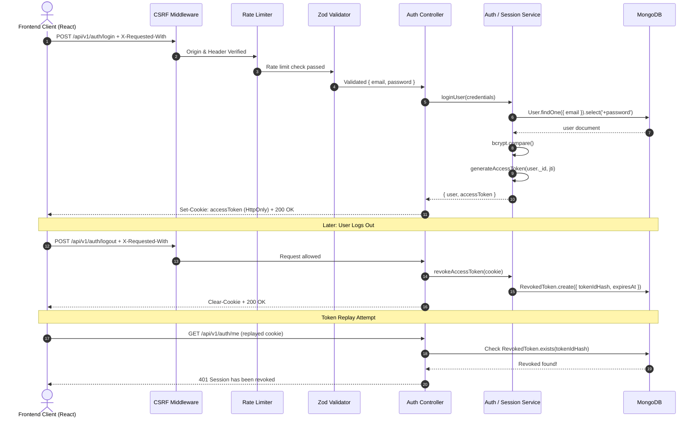

# Smart Hostel Management System

A modern, full-stack Hostel Management System featuring a **React 19** frontend built with **Vite** and a robust **Node.js / Express / MongoDB** backend. The system incorporates enterprise-grade authentication, role-based access control (RBAC), cryptographic token revocation, CSRF protection, strict Zod schema validation, dedicated brute-force rate limiters, admin bootstrap tooling, and an automated integration test suite.

---

## Table of Contents

- [Overview](#overview)
- [Tech Stack](#tech-stack)
  - [Frontend](#frontend)
  - [Backend](#backend)
- [Project Architecture](#project-architecture)
- [Environment Variables](#environment-variables)
  - [Backend (`server/.env`)](#backend-serverenv)
  - [Frontend (`client/.env`)](#frontend-clientenv)
- [Getting Started](#getting-started)
  - [Prerequisites](#prerequisites)
  - [Installation](#installation)
  - [Running the Backend](#running-the-backend)
  - [Running the Frontend](#running-the-frontend)
  - [Running Automated Tests](#running-automated-tests)
  - [Bootstrapping an Admin Account](#bootstrapping-an-admin-account)
- [Frontend Client Overview](#frontend-client-overview)
  - [Key Frontend Features](#key-frontend-features)
  - [Application Routes](#application-routes)
  - [CSRF & API Client Configuration](#csrf--api-client-configuration)
- [API Documentation](#api-documentation)
  - [Authentication Endpoints](#authentication-endpoints)
    - [1. Health Check](#1-health-check)
    - [2. User Registration](#2-user-registration)
    - [3. User Login](#3-user-login)
    - [4. User Logout (Session Revocation)](#4-user-logout-session-revocation)
    - [5. Current User Profile (`/me`)](#5-current-user-profile-me)
    - [6. Development Verification Routes](#6-development-verification-routes)
  - [Admin User Management Endpoints](#admin-user-management-endpoints)
    - [7. List All Users (Paginated & Filterable)](#7-list-all-users-paginated--filterable)
    - [8. Get User by ID](#8-get-user-by-id)
    - [9. Update Basic User Details](#9-update-basic-user-details)
    - [10. Activate / Deactivate User Status](#10-activate--deactivate-user-status)
    - [11. Update User Role](#11-update-user-role)
- [Security & Validation Architecture](#security--validation-architecture)
  - [CSRF Protection & Custom Header Requirement](#csrf-protection--custom-header-requirement)
  - [Token Revocation & Session Management](#token-revocation--session-management)
  - [Request Validation with Zod](#request-validation-with-zod)
  - [Dedicated Authentication Rate Limiters](#dedicated-authentication-rate-limiters)
  - [Centralized Error Handling](#centralized-error-handling)
- [Authentication & Security Flow](#authentication--security-flow)
- [Git Branching Strategy](#git-branching-strategy)

---

## Overview

The Smart Hostel system streamlines campus housing operations, student accommodation workflows, and residential facilities management:

- **Full-Stack Architecture**: Modern React 19 client paired with a high-performance Express REST API and MongoDB ODM.
- **Secure Authentication & Session Lifecycle**: Student self-registration, password hashing via bcrypt (12 rounds), JWT access tokens embedded with unique `jti` identifiers, HTTP-only secure cookies, cryptographic token revocation upon logout, and CSRF protection.
- **Role-Based Access Control (RBAC)**: Fine-grained permission guards across `student`, `warden`, `staff`, and `admin` roles.
- **User Administration**: Administrative portal APIs to search, filter, paginate, inspect, edit, activate/deactivate, and reassign user roles with built-in guardrails against self-demotion or self-lockout.
- **Hostel Domain Schemas**: Comprehensive data models covering hostels, rooms, beds, allocations, maintenance complaints, fee structures, payment records, notices, and visitor logging.
- **Resilient Security**: Strict Zod input validation schemas, dual brute-force rate limiters, Helmet HTTP security headers, and CORS origin whitelisting.

---

## Tech Stack

### Frontend
- **Framework**: React 19 (`react`, `react-dom`)
- **Tooling & Bundler**: Vite 8
- **Routing**: React Router v8 (`react-router`)
- **Networking**: Axios (with custom CSRF interceptors and unified error formatting)
- **Icons**: Lucide React (`lucide-react`)
- **Styling**: Vanilla CSS with modern tokens, glassmorphism, responsive grids, and Google Fonts typography
- **Testing & Quality Assurance**:
  - Vitest (`vitest`) native ESM runner
  - React Testing Library (`@testing-library/react`, `@testing-library/jest-dom`, `@testing-library/user-event`)
  - `axios-mock-adapter` and `jsdom` for isolated browser DOM & mock HTTP network environments

### Backend
- **Runtime**: Node.js (v18+, ES Modules)
- **Framework**: Express.js (v5)
- **Database**: MongoDB with Mongoose ODM
- **Schema Validation**: Zod (`zod`)
- **Authentication & Security**:
  - `jsonwebtoken`: Access tokens with unique `jti`, issuer, and audience claims
  - `bcryptjs`: Password hashing with 12 salt rounds
  - `helmet`: HTTP security response headers
  - `cors`: Strict origin whitelisting
  - `express-rate-limit`: Endpoint-specific request throttling
  - `cookie-parser`: Secure HTTP-only cookie parsing
- **Logging**: Morgan HTTP request logger
- **Testing & Quality Assurance**:
  - Node.js native test runner (`node --test`)
  - `supertest`: HTTP endpoint integration testing
  - `mongodb-memory-server`: Isolated in-memory MongoDB database for zero-dependency CI tests

---

## Project Architecture

```text
smart-hostel/
├── client/                               # Frontend application (React 19 / Vite)
│   ├── public/                           # Static assets, SVG icons, favicon
│   ├── src/
│   │   ├── api/                          # Networking layer
│   │   │   ├── health.api.js             # Backend connectivity check
│   │   │   └── httpClient.js             # Axios instance with CSRF interceptor
│   │   ├── assets/                       # UI illustrations & vector assets
│   │   ├── components/                   # Shared reusable UI elements
│   │   │   ├── common/
│   │   │   │   ├── BackendStatus.jsx     # Live backend connection indicator
│   │   │   │   └── SessionStatus.jsx     # Active session & role status pill
│   │   │   ├── dashboard/                # Reusable dashboard navigation & widgets
│   │   │   │   ├── DashboardCard.jsx     # Metric & summary display cards
│   │   │   │   ├── Sidebar.jsx           # Role-based collapsible navigation drawer
│   │   │   │   └── Topbar.jsx            # Top app header with profile & session actions
│   │   │   └── ui/                       # UI primitives
│   │   ├── config/                       # Client configuration
│   │   │   └── dashboardNavigation.js    # Role-specific navigation manifests
│   │   ├── context/                      # Global React context providers
│   │   │   ├── AuthContext.js            # Auth context definitions
│   │   │   └── AuthProvider.jsx          # Session state provider (cookie-driven)
│   │   ├── features/                     # Feature-sliced domain modules
│   │   │   ├── auth/                     # Authentication domain
│   │   │   │   ├── api/auth.api.js       # Register, login, logout, me API calls
│   │   │   │   ├── components/           # LoginForm, RegisterForm
│   │   │   │   ├── pages/                # LoginPage, RegisterPage
│   │   │   │   └── styles/auth.css       # Scoped auth module styles
│   │   │   └── users/                    # Admin user management domain
│   │   │       ├── api/users.api.js      # User query, role & status mutation APIs
│   │   │       ├── components/           # UserTable, UserDetailsPanel
│   │   │       ├── pages/                # AdminUsersPage
│   │   │       └── styles/users.css      # User management tables & panels
│   │   ├── hooks/                        # Custom React hooks
│   │   │   └── useAuth.js                # Hook to consume AuthContext
│   │   ├── layouts/
│   │   │   ├── DashboardLayout.jsx       # Authenticated role dashboard shell
│   │   │   └── PublicLayout.jsx          # Public navbar, status pill & footer
│   │   ├── pages/                        # General pages
│   │   │   ├── HomePage.jsx              # Landing showcase & role quick access
│   │   │   ├── RoleDashboardPage.jsx     # Personalized role-based dashboard view
│   │   │   ├── DashboardPage.jsx         # General dashboard landing
│   │   │   ├── ModulePlaceholderPage.jsx # Modular placeholder for upcoming features
│   │   │   ├── ComingSoonPage.jsx        # Modular placeholder page
│   │   │   └── NotFoundPage.jsx          # 404 handler
│   │   ├── routes/                       # Routing guards & configuration
│   │   │   ├── AppRoutes.jsx             # React Router configuration
│   │   │   ├── ProtectedRoute.jsx        # Authenticated session guard
│   │   │   ├── RoleRoute.jsx             # Role-based access control (RBAC) guard
│   │   │   └── GuestRoute.jsx            # Guest-only guard (redirects logged-in users)
│   │   ├── styles/
│   │   │   ├── global.css                # CSS variables, typography & reset
│   │   │   └── dashboard.css             # Dashboard layout & widget styles
│   │   ├── test/                         # Frontend integration tests & mocks
│   │   │   ├── auth.integration.test.jsx # Auth & routing integration tests
│   │   │   ├── users.integration.test.jsx# Admin user management tests
│   │   │   ├── mockBackend.js            # Axios mock adapter backend fixtures
│   │   │   └── setup.js                  # Vitest environment setup
│   │   ├── utils/                        # Frontend helper utilities
│   │   │   └── rolePaths.js              # Role home routes & path helpers
│   │   ├── App.jsx                       # Application shell with AuthProvider
│   │   └── main.jsx                      # Client root mount
│   ├── .env.example                      # Client environment template
│   ├── vite.config.js                    # Vite bundler configuration
│   ├── vitest.config.js                  # Vitest test suite configuration
│   └── package.json
│
├── server/                               # Backend REST API service (Node.js / Express)
│   ├── scripts/
│   │   └── bootstrap-admin.js            # Initial admin account elevation script
│   ├── src/
│   │   ├── config/
│   │   │   ├── db.js                     # MongoDB connection handler
│   │   │   └── env.js                    # Validated environment configuration
│   │   ├── controllers/                  # Route request handlers
│   │   │   ├── auth.controller.js        # Register, login, logout, profile
│   │   │   ├── user.controller.js        # Admin user management
│   │   │   ├── allocation.controller.js  # Room/bed allocations
│   │   │   ├── bed.controller.js         # Bed inventory
│   │   │   ├── complaint.controller.js   # Maintenance complaints
│   │   │   ├── fee.controller.js         # Fee structures
│   │   │   ├── hostel.controller.js      # Hostel blocks
│   │   │   ├── notice.controller.js      # Notice board
│   │   │   ├── payment.controller.js     # Payment transactions
│   │   │   ├── room.controller.js        # Room management
│   │   │   ├── student.controller.js     # Student records
│   │   │   └── visitor.controller.js     # Visitor logs
│   │   ├── middlewares/                  # Express middleware pipeline
│   │   │   ├── auth.middleware.js        # JWT verification & token revocation check
│   │   │   ├── authRateLimit.middleware.js # Registration & login brute-force guards
│   │   │   ├── csrf.middleware.js        # Custom header & origin validation
│   │   │   ├── error.middleware.js       # Centralized error handler
│   │   │   ├── notFound.middleware.js    # 404 handler
│   │   │   ├── role.middleware.js        # Role-based authorization guard (RBAC)
│   │   │   └── validate.middleware.js    # Zod schema validation middleware
│   │   ├── models/                       # Mongoose data schemas
│   │   │   ├── allocation.model.js
│   │   │   ├── bed.model.js
│   │   │   ├── complaint.model.js
│   │   │   ├── fee.model.js
│   │   │   ├── hostel.model.js
│   │   │   ├── notice.model.js
│   │   │   ├── payment.model.js
│   │   │   ├── revokedToken.model.js     # Revocation blacklist with TTL auto-cleanup
│   │   │   ├── room.model.js
│   │   │   ├── user.model.js
│   │   │   └── visitor.model.js
│   │   ├── routes/                       # Express router definitions
│   │   │   ├── auth.routes.js            # /api/v1/auth
│   │   │   ├── user.routes.js            # /api/v1/users
│   │   │   ├── allocation.routes.js
│   │   │   ├── bed.routes.js
│   │   │   ├── complaint.routes.js
│   │   │   ├── fee.routes.js
│   │   │   ├── hostel.routes.js
│   │   │   ├── notice.routes.js
│   │   │   ├── payment.routes.js
│   │   │   ├── room.routes.js
│   │   │   ├── student.routes.js
│   │   │   └── visitor.routes.js
│   │   ├── services/                     # Business logic layer
│   │   │   ├── auth.service.js
│   │   │   ├── session.service.js        # Token blacklist & revocation handling
│   │   │   ├── user.service.js           # Admin user search & mutations
│   │   │   └── ...                       # Domain services (room, hostel, fee, etc.)
│   │   ├── utils/                        # Utilities & helpers
│   │   │   ├── ApiError.js               # Structured error class
│   │   │   ├── asyncHandler.js           # Express async wrapper
│   │   │   ├── response.js               # Standardized JSON response envelope
│   │   │   └── token.js                  # JWT issuance, parsing & SHA-256 hashing
│   │   ├── validators/                   # Zod validation schemas
│   │   │   ├── auth.validator.js
│   │   │   ├── user.validator.js
│   │   │   └── ...
│   │   ├── app.js                       # Express app assembly & global middleware
│   │   └── server.js                    # HTTP listener bootstrap
│   ├── tests/
│   │   └── auth.integration.test.js     # End-to-end integration test suite
│   ├── .env.example
│   └── package.json
└── README.md
```

---

## Environment Variables

### Backend (`server/.env`)

Configure the following variables in `server/.env`:

```env
PORT=5001
MONGODB_URI=mongodb://127.0.0.1:27017/hostel_management
JWT_SECRET=your_super_secret_jwt_key_here
JWT_EXPIRES_IN=7d
CLIENT_URL=http://localhost:5173
NODE_ENV=development
```

> **macOS Note**: Port `5001` is used by default because port `5000` is reserved by the macOS AirPlay Receiver (`AirTunes`).

### Frontend (`client/.env`)

Configure the following variables in `client/.env`:

```env
VITE_API_BASE_URL=http://localhost:5001/api/v1
```

---

## Getting Started

### Prerequisites
- **Node.js**: v18.0.0 or higher
- **npm**: v9.0.0 or higher
- **MongoDB**: Local MongoDB instance (e.g. `brew services start mongodb-community`) or a remote MongoDB Atlas URI

### Installation

1. Clone the repository:
   ```bash
   git clone https://github.com/shiv-pencia/SmartHostel-.git
   cd SmartHostel-
   ```

2. Install backend dependencies:
   ```bash
   cd server
   npm install
   ```

3. Install frontend dependencies:
   ```bash
   cd ../client
   npm install
   ```

4. Set up environment files:
   ```bash
   # In server/
   cp .env.example .env

   # In client/
   cp .env.example .env
   ```

### Running the Backend

From the `server` directory:

```bash
# Development Mode (auto-restart with nodemon)
npm run dev

# Production Mode
npm start
```

Backend will be accessible at: `http://localhost:5001`

### Running the Frontend

In a separate terminal, from the `client` directory:

```bash
# Development Mode (Vite dev server)
npm run dev

# Production Build
npm run build

# Preview Production Build
npm run preview
```

Frontend will be accessible at: `http://localhost:5173`

### Running Automated Tests

#### Backend Integration Tests
The backend includes a zero-dependency integration test suite running on Node's native test runner with `supertest` and `mongodb-memory-server` (an external MongoDB instance is not required):

```bash
cd server
npm test
```

#### Frontend Integration Tests
The frontend includes a full Vitest and React Testing Library suite testing authentication flows, route guards, user tables, search/filter interactions, status toggling, and role mutations:

```bash
cd client
npm test            # Run all client tests
npm run test:watch  # Interactive watch mode
```

### Bootstrapping an Admin Account

To promote the first registered user to administrator in a development environment:

1. Register an initial user (e.g. `admin@hostel.edu`) via the `/register` frontend page or the `/api/v1/auth/register` API.
2. Run the bootstrap script:
   ```bash
   cd server
   BOOTSTRAP_ADMIN_EMAIL="admin@hostel.edu" node scripts/bootstrap-admin.js
   ```

---

## Frontend Client Overview

### Key Frontend Features

1. **Global Authentication State (`AuthProvider`)**:
   - Automatic session hydration on mount via `GET /api/v1/auth/me`.
   - Cookie-based authentication lifecycle with seamless login, logout, and token revocation.
   - Request sequence tracking preventing stale responses from overriding active state.
2. **Role-Based Access Control (RBAC) & Route Guards**:
   - **`ProtectedRoute`**: Restricts internal views to authenticated users, remembering intended destination paths.
   - **`RoleRoute`**: Enforces strict role access (`student`, `warden`, `staff`, `admin`), preventing unauthorized role escalation.
   - **`GuestRoute`**: Guards guest-only pages (`/login`, `/register`), redirecting logged-in users to their respective role dashboards.
3. **Responsive Dashboard System (`DashboardLayout`)**:
   - Collapsible sidebar with navigation items tailored to the user's active role.
   - Topbar featuring live session indicator (`SessionStatus`), user profile badge, and one-click session logout.
   - Personalized `RoleDashboardPage` displaying targeted metric counters, quick actions, and role-specific module cards.
4. **Admin User Management Portal (`AdminUsersPage`)**:
   - Interactive data table with query search (name/email), role filter, and active/inactive status filter.
   - Server-side paginated navigation with total record count and page indicators.
   - Slide-out details drawer (`UserDetailsPanel`) allowing direct status toggles and role modifications with server safety confirmations.
5. **Interactive Auth Forms**:
   - Real-time client-side validation, password length bounds, and confirmation matching.
   - Accessible form controls (`aria-invalid`, `role="alert"`).
   - Submitting state feedback preventing duplicate requests.
6. **Live Backend Connectivity Monitor**:
   - Real-time `BackendStatus` badge querying `/api/v1/health` with instant status indicators (Operational, Offline, Checking).

### Application Routes

| Path | View Component | Access Guard | Description |
| :--- | :--- | :--- | :--- |
| `/` | `HomePage` | Public | Landing page featuring platform statistics, features, and role-based access portals |
| `/login` | `LoginPage` | Guest-only | Student & administrator login portal |
| `/register` | `RegisterPage` | Guest-only | Student registration portal with live input validation |
| `/dashboard` | `DashboardRedirect` | Authenticated | Automatically redirects authenticated users to their role-specific home route |
| `/admin` | `RoleDashboardPage` | `admin` | Administrator overview with system statistics & management shortcuts |
| `/admin/users` | `AdminUsersPage` | `admin` | Full user management portal with search, filtering, status toggling, and role assignment |
| `/admin/hostels` | `ModulePlaceholderPage` | `admin` | Hostel block management module |
| `/admin/rooms` | `ModulePlaceholderPage` | `admin` | Room & bed inventory module |
| `/admin/reports` | `ModulePlaceholderPage` | `admin` | Reports & system analytics module |
| `/student` | `RoleDashboardPage` | `student` | Student overview with room info, complaint status, and quick links |
| `/student/allocation` | `ModulePlaceholderPage` | `student` | Room and bed allocation details module |
| `/student/complaints` | `ModulePlaceholderPage` | `student` | Maintenance complaint submission & tracking module |
| `/student/notices` | `ModulePlaceholderPage` | `student` | Hostel notice board module |
| `/warden` | `RoleDashboardPage` | `warden` | Warden overview with occupancy metrics, complaints, and visitor logs |
| `/warden/rooms` | `ModulePlaceholderPage` | `warden` | Room inspection and occupancy management module |
| `/warden/visitors` | `ModulePlaceholderPage` | `warden` | Visitor log and gate pass monitoring module |
| `/warden/complaints` | `ModulePlaceholderPage` | `warden` | Student complaint assignment and resolution module |
| `/staff` | `RoleDashboardPage` | `staff` | Maintenance staff overview with active repair tasks & workload |
| `/staff/tasks` | `ModulePlaceholderPage` | `staff` | Assigned maintenance work orders module |
| `/staff/maintenance` | `ModulePlaceholderPage` | `staff` | Maintenance history and completion logs module |
| `*` | `NotFoundPage` | Public | Custom 404 page with return-to-home navigation |

### CSRF & API Client Configuration

All HTTP communication utilizes a centralized Axios instance configured in [`client/src/api/httpClient.js`](client/src/api/httpClient.js):
- **Credentials Support**: `withCredentials: true` ensures authentication cookies (`accessToken`) are transmitted with every request.
- **CSRF Token Interceptor**: Automatically attaches `X-Requested-With: XMLHttpRequest` on state-mutating HTTP methods (`POST`, `PUT`, `PATCH`, `DELETE`).
- **Normalized Error Handling**: Converts network failures, timeouts, and API error bodies into a structured `ApiRequestError` format.

---

## API Documentation

Base URL: `http://localhost:5001`

> [!IMPORTANT]
> **CSRF Protection Header**: All state-mutating requests (`POST`, `PATCH`, `PUT`, `DELETE`) require the `X-Requested-With: XMLHttpRequest` header. Requests without this header or from untrusted origins are rejected with `403 Forbidden`.

---

### Authentication Endpoints

#### 1. Health Check

Checks if the server is alive and operational.

- **Method**: `GET`
- **Route**: `/api/v1/health`
- **Authentication**: None

```bash
curl -X GET http://localhost:5001/api/v1/health
```

**Response (`200 OK`)**:
```json
{
  "success": true,
  "message": "Smart Hostel API is running"
}
```

---

#### 2. User Registration

Registers a new student account with strict Zod validation and rate limiting.

- **Method**: `POST`
- **Route**: `/api/v1/auth/register`
- **Rate Limit**: 5 attempts per IP per hour
- **Required Headers**: `Content-Type: application/json`, `X-Requested-With: XMLHttpRequest`

**Request Body Schema**:
| Field | Type | Required | Constraints |
| :--- | :--- | :--- | :--- |
| `name` | String | Yes | 2 to 100 characters, trimmed |
| `email` | String | Yes | Valid email format, lowercase |
| `password` | String | Yes | 8 to 128 characters, max 72 bytes |
| `phone` | String | No | 10 to 15 digits, optional `+` prefix |

**Sample Request**:
```bash
curl -X POST http://localhost:5001/api/v1/auth/register \
  -H "Content-Type: application/json" \
  -H "X-Requested-With: XMLHttpRequest" \
  -d '{
    "name": "Shiv Prakash",
    "email": "shiv@example.com",
    "password": "StudentPass@123",
    "phone": "+919876543210"
  }'
```

**Response (`201 Created`)**:
```json
{
  "success": true,
  "message": "Student registered successfully",
  "data": {
    "user": {
      "id": "6acb89cdcca5f3892ad245b6",
      "name": "Shiv Prakash",
      "email": "shiv@example.com",
      "phone": "+919876543210",
      "role": "student",
      "isActive": true,
      "lastLoginAt": null,
      "createdAt": "2026-10-12T10:00:00.000Z",
      "updatedAt": "2026-10-12T10:00:00.000Z"
    }
  }
}
```

---

#### 3. User Login

Authenticates user credentials, sets an `accessToken` HTTP-only cookie, and logs the login timestamp.

- **Method**: `POST`
- **Route**: `/api/v1/auth/login`
- **Rate Limit**: 10 failed attempts per IP per 15 minutes
- **Required Headers**: `Content-Type: application/json`, `X-Requested-With: XMLHttpRequest`

**Sample Request**:
```bash
curl -i -X POST http://localhost:5001/api/v1/auth/login \
  -H "Content-Type: application/json" \
  -H "X-Requested-With: XMLHttpRequest" \
  -d '{
    "email": "shiv@example.com",
    "password": "StudentPass@123"
  }'
```

**Response (`200 OK`)**:
```http
HTTP/1.1 200 OK
Set-Cookie: accessToken=eyJhbGciOiJIUzI1NiIsInR5cCI6IkpXVCJ9...; Max-Age=900; Path=/; HttpOnly; SameSite=Lax
Cache-Control: no-store

{
  "success": true,
  "message": "Login successful",
  "data": {
    "user": {
      "id": "6acb89cdcca5f3892ad245b6",
      "name": "Shiv Prakash",
      "email": "shiv@example.com",
      "role": "student",
      "isActive": true,
      "lastLoginAt": "2026-10-12T10:05:00.000Z"
    }
  }
}
```

---

#### 4. User Logout (Session Revocation)

Revokes the active JWT access token in MongoDB using its cryptographic identifier (`jti`) and clears the HTTP-only cookie.

- **Method**: `POST`
- **Route**: `/api/v1/auth/logout`
- **Authentication**: Optional (clears cookies regardless, revokes token if valid)
- **Required Headers**: `X-Requested-With: XMLHttpRequest`

**Sample Request**:
```bash
curl -i -X POST http://localhost:5001/api/v1/auth/logout \
  -H "X-Requested-With: XMLHttpRequest" \
  --cookie "accessToken=eyJhbGciOiJIUzI1NiIsInR5cCI6IkpXVCJ9..."
```

**Response (`200 OK`)**:
```json
{
  "success": true,
  "message": "Logout successful"
}
```

---

#### 5. Current User Profile (`/me`)

Retrieves the currently authenticated user's profile.

- **Method**: `GET`
- **Route**: `/api/v1/auth/me`
- **Authentication**: Required (`accessToken` Cookie)

**Sample Request**:
```bash
curl -X GET http://localhost:5001/api/v1/auth/me \
  --cookie "accessToken=eyJhbGciOiJIUzI1NiIsInR5cCI6IkpXVCJ9..."
```

**Response (`200 OK`)**:
```json
{
  "success": true,
  "message": "Current user retrieved successfully",
  "data": {
    "user": {
      "id": "6acb89cdcca5f3892ad245b6",
      "name": "Shiv Prakash",
      "email": "shiv@example.com",
      "role": "student",
      "isActive": true
    }
  }
}
```

---

#### 6. Development Verification Routes

Available when `NODE_ENV=development`:
- `GET /api/v1/auth/profile-check`: Any valid authenticated user
- `GET /api/v1/auth/warden-check`: Only users with `warden` or `admin` role

---

### Admin User Management Endpoints

All routes under `/api/v1/users` require an authenticated user with `role: "admin"`.

#### 7. List All Users (Paginated & Filterable)

Lists user accounts with query-based filtering and pagination.

- **Method**: `GET`
- **Route**: `/api/v1/users`
- **Authentication**: Required (`admin`)
- **Query Parameters**:
  - `page`: Page number (integer, min: 1, default: `1`)
  - `limit`: Items per page (integer, min: 1, max: 100, default: `10`)
  - `search`: Case-insensitive text search matching `name` or `email`
  - `role`: Filter by role (`student`, `warden`, `staff`, `admin`)
  - `status`: Filter by account status (`active`, `inactive`)

**Sample Request**:
```bash
curl -X GET "http://localhost:5001/api/v1/users?role=student&status=active&page=1&limit=10" \
  --cookie "accessToken=ADMIN_TOKEN..."
```

**Response (`200 OK`)**:
```json
{
  "success": true,
  "message": "Users retrieved successfully",
  "data": [
    {
      "id": "6acb89cdcca5f3892ad245b6",
      "name": "Shiv Prakash",
      "email": "shiv@example.com",
      "phone": "+919876543210",
      "role": "student",
      "isActive": true,
      "createdAt": "2026-10-12T10:00:00.000Z"
    }
  ],
  "meta": {
    "page": 1,
    "limit": 10,
    "total": 1,
    "totalPages": 1
  }
}
```

---

#### 8. Get User by ID

Fetches a single user record by their MongoDB ID.

- **Method**: `GET`
- **Route**: `/api/v1/users/:userId`
- **Authentication**: Required (`admin`)

**Sample Request**:
```bash
curl -X GET http://localhost:5001/api/v1/users/6acb89cdcca5f3892ad245b6 \
  --cookie "accessToken=ADMIN_TOKEN..."
```

---

#### 9. Update Basic User Details

Updates non-sensitive profile information (`name`, `phone`).

- **Method**: `PATCH`
- **Route**: `/api/v1/users/:userId`
- **Authentication**: Required (`admin`)
- **Required Headers**: `Content-Type: application/json`, `X-Requested-With: XMLHttpRequest`

**Sample Request**:
```bash
curl -X PATCH http://localhost:5001/api/v1/users/6acb89cdcca5f3892ad245b6 \
  -H "Content-Type: application/json" \
  -H "X-Requested-With: XMLHttpRequest" \
  --cookie "accessToken=ADMIN_TOKEN..." \
  -d '{
    "name": "Shiv Pencia",
    "phone": "+919876543299"
  }'
```

---

#### 10. Activate / Deactivate User Status

Enables or disables a user account. Deactivated users cannot log in or authenticate.

- **Method**: `PATCH`
- **Route**: `/api/v1/users/:userId/status`
- **Authentication**: Required (`admin`)
- **Required Headers**: `Content-Type: application/json`, `X-Requested-With: XMLHttpRequest`
- **Safety Guards**:
  - Administrators cannot deactivate their own account (`403 Forbidden`).
  - Administrator accounts cannot have their status altered through this endpoint (`403 Forbidden`).

**Sample Request**:
```bash
curl -X PATCH http://localhost:5001/api/v1/users/6acb89cdcca5f3892ad245b6/status \
  -H "Content-Type: application/json" \
  -H "X-Requested-With: XMLHttpRequest" \
  --cookie "accessToken=ADMIN_TOKEN..." \
  -d '{ "isActive": false }'
```

---

#### 11. Update User Role

Reassigns a user's role to `student`, `warden`, or `staff`.

- **Method**: `PATCH`
- **Route**: `/api/v1/users/:userId/role`
- **Authentication**: Required (`admin`)
- **Required Headers**: `Content-Type: application/json`, `X-Requested-With: XMLHttpRequest`
- **Safety Guards**:
  - Administrators cannot change their own role (`403 Forbidden`).
  - Existing administrators cannot be demoted via this endpoint (`403 Forbidden`).
  - Promoting accounts directly to `admin` is blocked; initial admin setup uses the bootstrap script (`403 Forbidden`).

**Sample Request**:
```bash
curl -X PATCH http://localhost:5001/api/v1/users/6acb89cdcca5f3892ad245b6/role \
  -H "Content-Type: application/json" \
  -H "X-Requested-With: XMLHttpRequest" \
  --cookie "accessToken=ADMIN_TOKEN..." \
  -d '{ "role": "warden" }'
```

---

## Security & Validation Architecture

### CSRF Protection & Custom Header Requirement

All mutating HTTP requests (`POST`, `PATCH`, `PUT`, `DELETE`) are processed by [`csrf.middleware.js`](server/src/middlewares/csrf.middleware.js):
1. **Origin Verification**: Requests containing an `Origin` header that does not match `CLIENT_URL` are rejected.
2. **Custom Header Enforcement**: Requests must supply `X-Requested-With: XMLHttpRequest`. Standard HTML forms or cross-site scripts cannot submit custom headers without CORS preflight permissions.

### Token Revocation & Session Management

1. **Cryptographic `jti`**: Every JWT issued contains a distinct UUID in the `jti` claim.
2. **Revocation Blacklist**: When a user logs out (`POST /auth/logout`), the token's `jti` is hashed with SHA-256 and stored in the `revoked_tokens` MongoDB collection via [`session.service.js`](server/src/services/session.service.js).
3. **Automatic TTL Index**: The `revoked_tokens` collection defines an index with `{ expireAfterSeconds: 0 }` on `expiresAt`. MongoDB automatically removes revoked records after their natural expiration date, preventing database bloat.
4. **Replay Rejection**: If an attacker attempts to replay a cookie or stolen token after logout, [`auth.middleware.js`](server/src/middlewares/auth.middleware.js) checks `isTokenRevoked()` and rejects the session immediately with `401 Unauthorized`.

### Request Validation with Zod

- Strict object enforcement (`z.strictObject()`) rejects extraneous properties.
- Normalization (trimming, lowercase for emails).
- Enforces bcrypt safe password limits (max 72 bytes).
- Detailed validation error responses map each issue to its corresponding field name.

### Dedicated Authentication Rate Limiters

- **Registration Limiter**: 5 requests / IP / hour.
- **Login Limiter**: 10 failed attempts / IP / 15 minutes (`skipSuccessfulRequests: true`).

### Centralized Error Handling

Implemented in [`error.middleware.js`](server/src/middlewares/error.middleware.js):
- Handles Mongoose `ValidationError`, `CastError`, MongoDB unique duplicate key (`11000`), and malformed JSON syntax.
- Sanitizes error outputs in production (`500 Internal Server Error` stacks are never exposed to clients).

---

## Authentication & Security Flow



---

## Git Branching Strategy

The repository follows a collaborative branch workflow:

| Branch | Description |
| :--- | :--- |
| **`main`** | Production-ready stable release branch |
| **`shiv`** | Shiv's development branch (features & authentication) |
| **`prinjam`** | Prinjam's feature branch |
| **`sourabh`** | Sourabh's feature branch |
